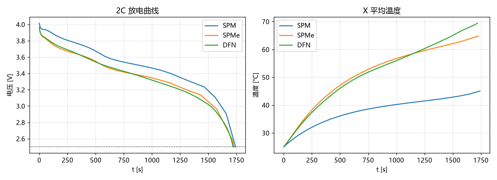
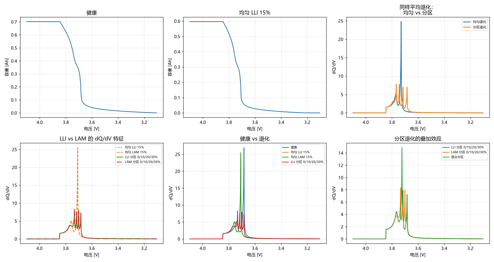
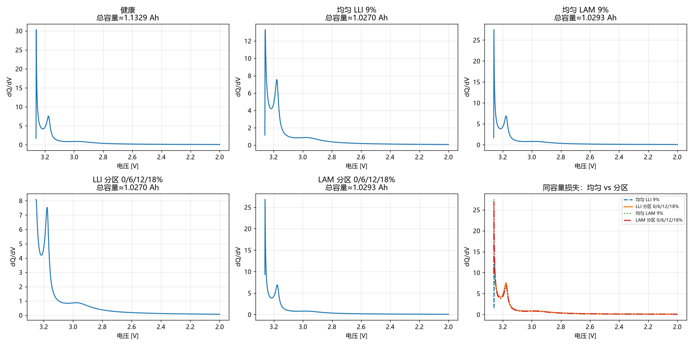
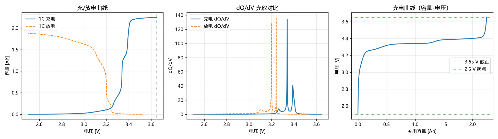
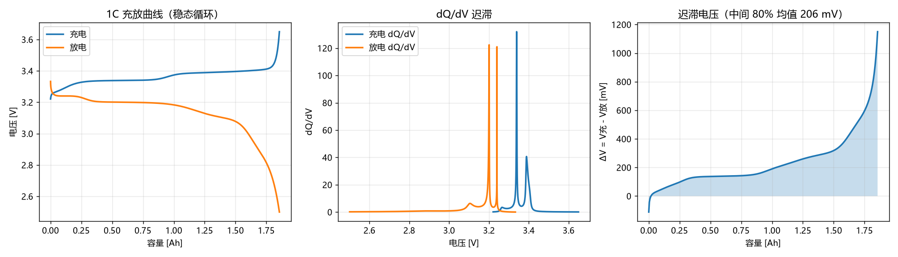
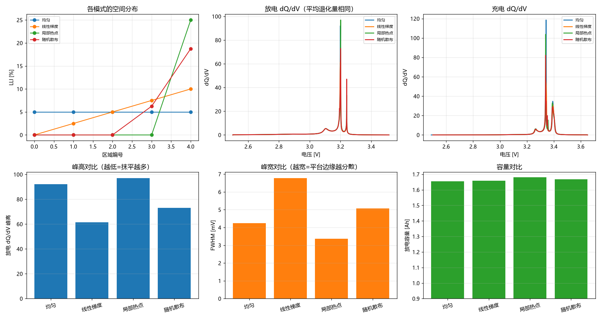

# Battery Modelling with PyBaMM

用 [PyBaMM](https://pybamm.org) 做的锂离子电池快速仿真实验集：模型层级对比、循环老化、
软包电芯面内不均匀性、以及区域化退化对 dQ/dV 的影响。

配套还有一份 **POLIDEMO**（Poli 组的电化学-力学耦合退化框架）的复现工具链，
用于交叉校验与长寿命加速仿真。

> 所有结论都基于本仓库内的脚本实跑得出；每个数字都可以用下面的命令复现。

---

## 环境要求

| 项 | 版本 |
|---|---|
| Python | 3.13（3.10–3.13 均可） |
| PyBaMM | 26.10.1.1 |
| 2D 网格 | scikit-fem 12.0.2（**2D 必需**，PyBaMM 默认不装） |

PyBaMM 会自动装 CasADi、SciPy 等底座，不需要单装 COMSOL 之类的商业软件。

### 安装（3 步）

```bash
git clone <this-repo>
cd <repo>

# 1. 建虚拟环境
python -m venv .venv

# 2. 激活
#    Windows PowerShell:
.\.venv\Scripts\Activate.ps1
#    Linux / macOS:
#    source .venv/bin/activate

# 3. 装依赖
pip install -r requirements.txt
```

> **注意**：`.venv/` 已加入 `.gitignore`，不会随仓库分发。虚拟环境是平台绑定的
> （Windows 的 `.venv` 拷到 Linux 直接用会坏），所以请在新机器上按上面 3 步重建。
>
> 需要字节级复现时用 `pip install -r requirements-lock.txt`（含全部传递依赖）。

### 自检

```bash
python verify.py
```

应当输出 `ALL CHECKS PASSED`。它会验证导入、2D 网格、以及一次真实 SPM 求解。

---

## 快速开始

```bash
# 1) 模型层级对比：SPM / SPMe / DFN 的代价与精度
python src/model_compare.py

# 2) 循环老化：SOH / LLI / LAM
python src/pybamm_aging.py 30

# 3) 软包 2D：面内不均匀性对容量与温度的影响
python src/pouch2d.py

# 4) 区域化 LLI/LAM 对 dQ/dV 的影响
python src/dqdv_regions.py
```

产物统一写到 `results/`。

---

## 主要结论（实测）

### 1. 模型层级：热比电更"挑模型"

2C 放电，Chen2020，lumped thermal：

| 模型 | 用时 | 末端温度 | 到 2.5 V |
|---|---|---|---|
| SPM | 0.07 s | 45.1 °C | 1742 s |
| SPMe | 0.18 s | 64.9 °C | 1727 s |
| DFN | 0.34 s | 69.4 °C | 1720 s |

SPM 电压全程高 100–200 mV，**温度差 24 °C**（SPM 缺电解液欧姆热与浓差热源）。
做热相关分析直接排除 SPM；本机 DFN 单次才 0.34 s，参数扫点完全够用。



### 2. 2D 面内不均匀：对容量几乎无影响，对温度影响明显

软包 2D（`dimensionality=2` + `potential pair`），1C–3C：

| 倍率 | 1D 容量 | 2D 容量 | 容量差 | 面内温差 |
|---|---|---|---|---|
| 1C | 0.6898 Ah | 0.6898 Ah | +0.003% | 0.01 K |
| 3C | 0.6752 Ah | 0.6753 Ah | +0.012% | 0.04 K |

大电芯（NCA_Kim2011，0.14×0.2 m）3C：容量差 +0.061%，**面内温差 0.91 K**。
集流体电导降到 1/16 时电流不均匀度从 5% 升到 59%。

**结论**：算容量/曲线用 1D 就够，不必上 2D；但温度场必须用 2D。


### 3. 区域化退化在 dQ/dV 上留下清晰指纹

同样 **15% 的平均容量损失**：

| 场景 | 容量 | dQ/dV 峰高 |
|---|---|---|
| 健康 | 0.7016 Ah | 27.0 |
| 均匀退化 | 0.5964 Ah | 25.5 |
| **分区退化 0/10/20/30%** | 0.5964 Ah | **8.3（−69%）** |

总容量完全一样，但 dQ/dV 峰形被显著抹平。**只看容量发现不了非均匀老化，dQ/dV 能。**



### 4. LFP/石墨：非均匀性让平台边缘峰被抹平

换 LFP（Prada2013，LFP_ocp_Afshar2017）跑同一套分区模型。LFP 的电压平台极平
（本参数集 **96.7% 容量挤在 3.15–3.35 V**），dQ/dV 是又高又窄的峰，非均匀性一眼可见。

该电芯为**石墨限容**，两个杠杆的落点：
LAM -> `Negative electrode active material volume fraction`；
LLI -> `Initial concentration in negative electrode`。

同样 **9% 平均容量损失**：

| 场景 | 容量 | 峰高 | 峰宽 FWHM |
|---|---|---|---|
| 健康 | 1.1329 Ah | 30.32 | 0.0070 V |
| 均匀 LLI 9% | 1.0270 Ah | 13.30 | 0.0154 V |
| **LLI 分区 0/6/12/18%** | 1.0270 Ah | **8.09（再降 39%）** | **0.0906 V（6 倍）** |
| 均匀 LAM 9% | 1.0293 Ah | 27.47 | 0.0070 V |
| LAM 分区 0/6/12/18% | 1.0293 Ah | 26.81 | 0.0070 V |

**结论**：容量完全相同，光看容量发现不了非均匀性。而且两种退化表现不同——
非均匀 **LLI** 把峰抹平（39%、6 倍宽），非均匀 **LAM** 几乎不动（2.4%）。
所以在 LFP 上"峰被抹平"更像是 **LLI 分布不均**的指纹，不是所有非均匀性的通用特征。



### 5. LFP 1C 充电：2.5 V → 3.65 V

`python src/charge_lfp.py`（Prada2013，1C = 2.3 A，C/20 无关，这里就是 1C 实倍率）：

| 指标 | 值 |
|---|---|
| 充电区间 | 2.501 V → 3.650 V（精确停在 3.65 V 事件） |
| 充电容量 | 2.2448 Ah |
| 用时 | 3514 s（≈0.98 h） |
| 充电 dQ/dV 峰 | 133.8 @ **3.339 V** |
| 放电 dQ/dV 峰 | 136.6 @ **3.240 V** |
| 充放峰位差 | **98 mV** |



### 6. LFP 1C 完整循环：库仑效率 / 能量效率 / dQ/dV 迟滞

`python src/cycle_lfp.py 3`（稳态循环，跳过首循环）：

| 指标 | 值 |
|---|---|
| 充/放容量 | 1.8559 / 1.8559 Ah（每循环完全一致） |
| **库仑效率 CE** | **100.000 %** |
| 充电能量 / 放电能量 | 6.2412 / 5.8034 Wh |
| **能量效率 EE** | **92.99 %** |
| 每循环能量损失 | 437.8 mWh |
| dQ/dV 峰（充 / 放） | 132.0 @ 3.339 V / 122.4 @ 3.201 V |
| 峰位差 | 138 mV |



### 7. 空间不均匀性模式对比 → [HTML 报告](reports/lfp_inhomogeneity_report.html)

`python src/uneven_lfp.py` 固定平均退化量（LLI/LAM 各 5%），只改变 5 个区域的
分布形状，看 dQ/dV 如何变化：

| 模式 | 放电容量 | 放电峰 | 相对均匀 | FWHM | 各区峰位跨度 |
|---|---|---|---|---|---|
| 均匀 | 1.6553 Ah | 92.1 | +0% | 4.2 mV | 0.0 mV |
| **线性梯度** | 1.6583 Ah | **61.4** | **−33%** | 6.8 mV | 4.2 mV |
| 随机散布 | 1.6682 Ah | 73.0 | −21% | 5.1 mV | 8.1 mV |
| 局部热点 | 1.6801 Ah | 97.0 | +5% | 3.4 mV | 12.3 mV |

**容量只差 1.5%，峰高差 33%。** 但真正决定峰形的不是"是否不均匀"，
而是**多少个区域处于相同状态**：梯度型 5 个区各不相同 → 叠加后被压平；
局部热点 4 个健康区完全一致 → 峰相干叠加，反而保持锐利。

> 关键提醒：各区峰位只移动约 12 mV，**没有出现真正的峰分裂**。
> 本模型中退化主要表现为容量缩放，不改变峰位。报告里有完整讨论与局限。



**CE=100% 而 EE=92.99% 并不矛盾**：CE 只算电荷量，EE 还算电压。
138 mV 的充放迟滞意味着每库仑电荷平均要多付 ~7% 的电压，能量就这样损失掉了。
所以对 LFP，**能量效率远比库仑效率更有信息量**。

> CE 恰好 100% 是因为本模型没开任何副反应（无 SEI/析锂/CEI）。
> 真实电芯的 CE 通常 99.5%~99.95%。要得到 <100%，需开退化模型；
> 但 Prada2013 缺 SEI 参数，得另补或换参数集。

**这里踩到的三个坑（都会让结果错得离谱）：**

1. **`Throughput capacity [A.h]` 是全实验累计值，不是本步值。**
   必须用相邻 step 的差分 ΔQ。否则会把 2.24+1.86 当成放电容量 4.10 Ah。
2. **第一个循环的充电容量偏高（2.2448 Ah），不能拿来做 CE。**
   起点 SOC 1.56%（为满足"从 2.5 V 充电"），首充要补这段；从第 2 循环起
   稳态值 1.8559 Ah，充放完全对称。
3. **求解器在 3.24 V 附近有一次容量跳变**（3.240139→3.240138 V 之间跳 0.013 Ah），
   直接差分会产生 1e3~1e4 量级的假尖峰，把真实峰（~130）完全淹没。
   必须同时按 ΔV 和尖峰倍数过滤。

**三个非直觉的点（都实测踩过）：**

1. **PyBaMM 里正电流=放电，负电流=充电。** 写成正值会变成放电。
2. **同一 SOC 的端电压取决于电流方向。** 静置 2.5 V 对应 SOC≈3.07%，
   但挂上 1C 充电后端电压被过电位抬到 2.72 V；要在**充电过程中**起于 2.5 V，
   SOC 得取 ≈1.56%。两者差 220 mV，就是 1C 的过电位。
3. **充电容量 2.24 Ah ≠ 放电容量 1.88 Ah**，差的 16% 不是损失。
   充电从 2.5 V 起（LFP 曲线的陡峭下端），只放掉一小截就上平台；
   放电从满电起放到 2.5 V（同样到陡峭端）。两者跨度不同，
   所以这两个数不能当库仑效率用。

---

## 已知限制（重要，别踩）

这些是我们实跑撞到的，不是猜测：

1. **PyBaMM 26.10 没有真正的 3D 电化学。** `dimensionality: 3` 在选项里声明了，
   但没有对应的电流集流体/热子模型，会直接 `UnboundLocalError`。最多是 2+1D。
2. **LAM 子模型不支持 2D。** 只要 `dimensionality>=1` 且开 `loss of active material`，
   就 `ModelError: rhs and initial conditions must have the same shape`。
   所以"2D 里给不同区域不同 LAM"目前**做不到**，只能手动分块并联。
3. **`swelling and cracking` + OKane2022 会让求解器崩。** 30 循环里 1 个就 hmin 塌缩；
   调 `rtol/atol/dt_max/newton_mode` 都无效。用 `swelling only` 稳定。
4. **dQ/dV 有两个独立问题，别混为一谈。**
   * **采样不足（数值问题）**：默认只输出 30–64 个点，直接微分全是毛刺。
     解法是调**时间步长** `dt_max`（或 `t_interp`/稠密 `t_eval`）。
     `dt_max` 更省：同样平滑度下 0.54 s vs `t_eval=4000` 的 2.32 s。
     注意这**与放电时长无关**——3600 s 缩到 60 s 只会让点数从 64 掉到 30。
   * **动力学畸变（物理问题）**：倍率越高，反应/传输过电位把 dQ/dV 峰压低、压偏。
     实测 1C→C/20，峰位偏移 **98 mV**，峰高从 9.96 变到 32.28（3.2 倍）。
     这个只能靠**降低倍率**解决，`t_interp` 救不了。
   本仓库两者都做：C/20 慢放 + 4000 点稠密输出。
5. **全电池 dQ/dV 分不开 LLI 与 LAM。** 二者在本降阶模型里结果完全相同——
   要分解必须靠电极级信息（半电池、参比电极、拆解）。

详细踩坑记录见 [docs/README_PyBaMM.md](docs/README_PyBaMM.md)。

---

## 仓库结构

```
.
├── src/                      # 可复现实验脚本
│   ├── model_compare.py      # SPM/SPMe/DFN 对比
│   ├── pybamm_aging.py       # 循环老化 SOH/LLI/LAM
│   ├── pouch2d.py            # 软包 2D 面内不均匀性
│   ├── dqdv_regions.py       # 区域化 LLI/LAM -> dQ/dV (LCO)
│   ├── dqdv_lfp.py           # 同模型，LFP/石墨，非均匀性更直观
│   ├── charge_lfp.py         # LFP 1C 充电 2.5->3.65 V + 充放 dQ/dV
│   ├── cycle_lfp.py          # LFP 1C 完整循环：CE / EE / dQ/dV 迟滞
│   ├── uneven_lfp.py         # 4 种空间不均匀模式 -> dQ/dV
│   └── make_report.py        # 生成 HTML 讨论报告
│   ├── polidemo_from_exe.py  # POLIDEMO 字节码加载器
│   └── common.py             # 共用工具（输出目录、中文字体）
├── examples/
│   └── demo_lifetime.py      # POLIDEMO 800 循环寿命复现
├── docs/
│   ├── README_PyBaMM.md      # 完整实验记录与踩坑清单
│   ├── POLIDEMO实现剖析.md    # POLIDEMO 模型拆解
│   └── polidemo_params_defaults.tsv  # POLIDEMO 默认参数表
├── reports/                  # HTML 讨论报告（单文件，图已内嵌）
├── results/                  # 运行产物（已提交，供 README 引用）
├── verify.py                 # 环境自检
├── requirements.txt          # 直接依赖
└── requirements-lock.txt     # 完整锁定版本
```

---

## 关于 POLIDEMO

`src/polidemo_from_exe.py` 直接从 `POLIDEMO.exe` 的 PyInstaller 归档里加载 `polidemo` 包，
**无需反编译**，可调用其 `ModelParams` / `run_cycles` / `run_lifetime`。

`POLIDEMO-windows/` 是**第三方二进制**，默认不入库（见 `.gitignore`）。
需要时从官方渠道获取 exe 放入该目录，或用环境变量指定路径：

```bash
# Linux / macOS
POLIDEMO_EXE=/path/to/POLIDEMO.exe python src/polidemo_from_exe.py
```

自检应输出 `20.2453 Ah / 0.000343 mm / 11150.2 s`。
加载器额外需要 `pyinstaller`（已列入 requirements.txt）。

---

## 引用

- Sulzer et al. (2021). *Python Battery Mathematical Modelling (PyBaMM)*.
  J. Open Research Software, 9(1), 14.
- Marquis et al. (2019). *An asymptotic derivation of a single particle model with
  electrolyte and thermal effects*. J. Electrochem. Soc., 166(15), A3693.
- POLIDEMO: *Applied Energy* **404** (2026) 126744.
  （原始论文请通过期刊获取；本仓库不再附带 PDF，仅提供加载器与参数表。）

## License

MIT —— 见 [LICENSE](LICENSE)。

本仓库**不包含**任何第三方论文全文或二进制：
`POLIDEMO-windows/` 不入库，论文 PDF 已移除。`docs/polidemo_params_defaults.tsv`
是从 POLIDEMO 提取的参数表，仅用于复现对照，版权归原作者。
