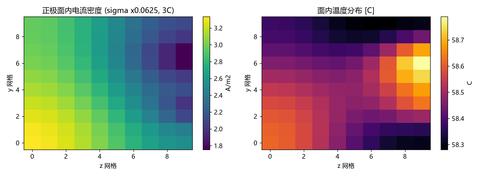

# Battery Modelling with PyBaMM

用 [PyBaMM](https://pybamm.org) 做的锂离子电池快速仿真实验集：模型层级对比、循环老化、
软包电芯面内不均匀性、以及区域化退化对 dQ/dV 的影响。

配套还有一份 **POLIDEMO**（Poli 组的电化学-力学耦合退化框架）的复现工具链，
用于交叉校验与长寿命加速仿真。

> 所有结论都基于本仓库内的脚本实跑得出；每个数字都可以用下面的命令复现。

---

## 环境要求

| 项 | 版本 |
|---|---|
| Python | 3.13（3.10–3.13 均可） |
| PyBaMM | 26.10.1.1 |
| 2D 网格 | scikit-fem 12.0.2（**2D 必需**，PyBaMM 默认不装） |

PyBaMM 会自动装 CasADi、SciPy 等底座，不需要单装 COMSOL 之类的商业软件。

### 安装（3 步）

```bash
git clone <this-repo>
cd <repo>

# 1. 建虚拟环境
python -m venv .venv

# 2. 激活
#    Windows PowerShell:
.\.venv\Scripts\Activate.ps1
#    Linux / macOS:
#    source .venv/bin/activate

# 3. 装依赖
pip install -r requirements.txt
```

> **注意**：`.venv/` 已加入 `.gitignore`，不会随仓库分发。虚拟环境是平台绑定的
> （Windows 的 `.venv` 拷到 Linux 直接用会坏），所以请在新机器上按上面 3 步重建。
>
> 需要字节级复现时用 `pip install -r requirements-lock.txt`（含全部传递依赖）。

### 自检

```bash
python verify.py
```

应当输出 `ALL CHECKS PASSED`。它会验证导入、2D 网格、以及一次真实 SPM 求解。

---

## 快速开始

```bash
# 1) 模型层级对比：SPM / SPMe / DFN 的代价与精度
python src/model_compare.py

# 2) 循环老化：SOH / LLI / LAM
python src/pybamm_aging.py 30

# 3) 软包 2D：面内不均匀性对容量与温度的影响
python src/pouch2d.py

# 4) 区域化 LLI/LAM 对 dQ/dV 的影响
python src/dqdv_regions.py
```

产物统一写到 `results/`。

---

## 主要结论（实测）

### 1. 模型层级：热比电更"挑模型"

2C 放电，Chen2020，lumped thermal：

| 模型 | 用时 | 末端温度 | 到 2.5 V |
|---|---|---|---|
| SPM | 0.07 s | 45.1 °C | 1742 s |
| SPMe | 0.18 s | 64.9 °C | 1727 s |
| DFN | 0.34 s | 69.4 °C | 1720 s |

SPM 电压全程高 100–200 mV，**温度差 24 °C**（SPM 缺电解液欧姆热与浓差热源）。
做热相关分析直接排除 SPM；本机 DFN 单次才 0.34 s，参数扫点完全够用。


### 2. 2D 面内不均匀：对容量几乎无影响，对温度影响明显

软包 2D（`dimensionality=2` + `potential pair`），1C–3C：

| 倍率 | 1D 容量 | 2D 容量 | 容量差 | 面内温差 |
|---|---|---|---|---|
| 1C | 0.6898 Ah | 0.6898 Ah | +0.003% | 0.01 K |
| 3C | 0.6752 Ah | 0.6753 Ah | +0.012% | 0.04 K |

大电芯（NCA_Kim2011，0.14×0.2 m）3C：容量差 +0.061%，**面内温差 0.91 K**。
集流体电导降到 1/16 时电流不均匀度从 5% 升到 59%。

**结论**：算容量/曲线用 1D 就够，不必上 2D；但温度场必须用 2D。



### 3. 区域化退化在 dQ/dV 上留下清晰指纹

同样 **15% 的平均容量损失**：

| 场景 | 容量 | dQ/dV 峰高 |
|---|---|---|
| 健康 | 0.7016 Ah | 27.0 |
| 均匀退化 | 0.5964 Ah | 25.5 |
| **分区退化 0/10/20/30%** | 0.5964 Ah | **8.3（−69%）** |

总容量完全一样，但 dQ/dV 峰形被显著抹平。**只看容量发现不了非均匀老化，dQ/dV 能。**


---

## 已知限制（重要，别踩）

这些是我们实跑撞到的，不是猜测：

1. **PyBaMM 26.10 没有真正的 3D 电化学。** `dimensionality: 3` 在选项里声明了，
   但没有对应的电流集流体/热子模型，会直接 `UnboundLocalError`。最多是 2+1D。
2. **LAM 子模型不支持 2D。** 只要 `dimensionality>=1` 且开 `loss of active material`，
   就 `ModelError: rhs and initial conditions must have the same shape`。
   所以"2D 里给不同区域不同 LAM"目前**做不到**，只能手动分块并联。
3. **`swelling and cracking` + OKane2022 会让求解器崩。** 30 循环里 1 个就 hmin 塌缩；
   调 `rtol/atol/dt_max/newton_mode` 都无效。用 `swelling only` 稳定。
4. **dQ/dV 必须用准静态。** 1C 放电只给 36 个点，直接微分全是毛刺。
   本仓库用 C/20 慢放 + 稠密 `t_interp`。
5. **全电池 dQ/dV 分不开 LLI 与 LAM。** 二者在本降阶模型里结果完全相同——
   要分解必须靠电极级信息（半电池、参比电极、拆解）。

详细踩坑记录见 [docs/README_PyBaMM.md](docs/README_PyBaMM.md)。

---

## 仓库结构

```
.
├── src/                      # 可复现实验脚本
│   ├── model_compare.py      # SPM/SPMe/DFN 对比
│   ├── pybamm_aging.py       # 循环老化 SOH/LLI/LAM
│   ├── pouch2d.py            # 软包 2D 面内不均匀性
│   ├── dqdv_regions.py       # 区域化 LLI/LAM -> dQ/dV
│   ├── polidemo_from_exe.py  # POLIDEMO 字节码加载器
│   └── common.py             # 共用工具（输出目录、中文字体）
├── examples/
│   └── demo_lifetime.py      # POLIDEMO 800 循环寿命复现
├── docs/
│   ├── README_PyBaMM.md      # 完整实验记录与踩坑清单
│   ├── POLIDEMO实现剖析.md    # POLIDEMO 模型拆解
│   └── polidemo_params_defaults.tsv  # POLIDEMO 默认参数表
├── results/                  # 运行产物（已提交，供 README 引用）
├── verify.py                 # 环境自检
├── requirements.txt          # 直接依赖
└── requirements-lock.txt     # 完整锁定版本
```

---

## 关于 POLIDEMO

`src/polidemo_from_exe.py` 直接从 `POLIDEMO.exe` 的 PyInstaller 归档里加载 `polidemo` 包，
**无需反编译**，可调用其 `ModelParams` / `run_cycles` / `run_lifetime`。

`POLIDEMO-windows/` 是**第三方二进制**，默认不入库（见 `.gitignore`）。
需要时从官方渠道获取 exe 放入该目录，或用环境变量指定路径：

```bash
# Linux / macOS
POLIDEMO_EXE=/path/to/POLIDEMO.exe python src/polidemo_from_exe.py
```

自检应输出 `20.2453 Ah / 0.000343 mm / 11150.2 s`。
加载器额外需要 `pyinstaller`（已列入 requirements.txt）。

---

## 引用

- Sulzer et al. (2021). *Python Battery Mathematical Modelling (PyBaMM)*.
  J. Open Research Software, 9(1), 14.
- Marquis et al. (2019). *An asymptotic derivation of a single particle model with
  electrolyte and thermal effects*. J. Electrochem. Soc., 166(15), A3693.
- POLIDEMO: *Applied Energy* **404** (2026) 126744.
  （原始论文请通过期刊获取；本仓库不再附带 PDF，仅提供加载器与参数表。）

## License

MIT —— 见 [LICENSE](LICENSE)。

本仓库**不包含**任何第三方论文全文或二进制：
`POLIDEMO-windows/` 不入库，论文 PDF 已移除。`docs/polidemo_params_defaults.tsv`
是从 POLIDEMO 提取的参数表，仅用于复现对照，版权归原作者。
